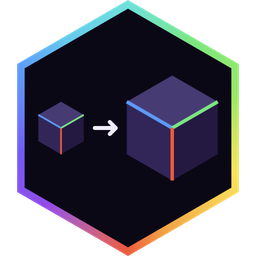

<div align="center">



# Alaydriem's Zoom

[](https://github.com/alaydriem/zoom/releases)
[](https://github.com/alaydriem/zoom/actions/workflows/build.yml)
[](./LICENSE)

[](https://github.com/alaydriem/amml)

</div>

Hold-to-zoom for Minecraft Bedrock, with a smooth ease in and out. Mouse sensitivity drops to match the zoom.

Client-side only.

## Usage

Hold <kbd>~</kbd> to zoom. The key can be changed on the mod manager's Keybinds page.

## Installation

Requires the AMML loader (as a LeviLamina mod, or standalone in a patched game folder) and [Alaydriem's Mod Manager](https://github.com/alaydriem/modmanager). Without the mod manager the zoom stays off.

Copy the `dist/@alaydriem/zoom/` folder (`alaydriem_zoom.dll` and `amml.hcl`) into `mods/amml/@alaydriem/zoom/` of the game folder.

| Zoom | Minecraft Bedrock | AMML | Mod Manager |
| --- | --- | --- | --- |
| 26.60.0 | 1.26.51, 1.26.60 | 26.60.x | 0.1.x |

## Configuration

Settings are in the mod manager panel and saved to `mods/amml/@alaydriem/zoom/config/config.hcl`.

| Setting | Default | Description |
| --- | --- | --- |
| `zoom.zoom_factor` | `4.0` | Zoom amount (1–32) |
| `zoom.zoom_in_ms` | `250` | Zoom-in time in ms (0–2000) |
| `zoom.zoom_out_ms` | `250` | Zoom-out time in ms (0–2000) |
| `zoom.easing` | `"easeInOutCubic"` | `linear`, `easeOutSine`, `easeOutCubic`, `easeOutQuint`, `easeOutExpo` or `easeInOutCubic` |
| `zoom.sensitivity_match_strength` | `1.0` | How much the mouse slows down (`0` = not at all) |
| `zoom.fade_variable_fov_while_zoomed` | `true` | Ignore sprint and effect FOV changes while zoomed |
| `keys.zoom` | `"Grave"` | Zoom key |

## Building

Requires Windows x64, [mise](https://mise.jdx.dev), rustup and [cargo-nextest](https://nexte.st). The AMML SDK and the mod manager crates are git dependencies on their public release tags (`Cargo.toml`); cargo fetches them.

```powershell
mise trust
mise run preflight
mise run package
mise run test
```

`mise run package` writes `dist/@alaydriem/zoom/` (`alaydriem_zoom.dll` and `amml.hcl`). `mise run install [--instance <name>]` runs `package`, then copies it into `%LOCALAPPDATA%\amml\instances\<name>\mods\amml\@alaydriem\zoom\` (default instance `1.26.60.05`). Close the game first.

The game functions zoom hooks are found by AMML recipes in the `amml` repository (`recipes/`).

## License

BSD 3-Clause. Copyright (c) 2026 Charles R. Portwood II. See [LICENSE](./LICENSE).
